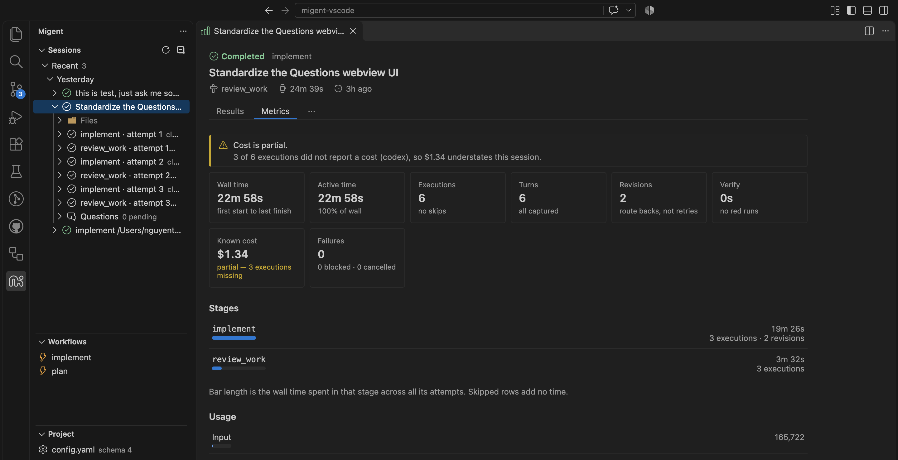

# Migent for VS Code

Workflow runner and AI agent orchestrator for VS Code.

Run multi-stage AI workflows, control agent sessions, and handle human checkpoints directly from your editor.



## What is Migent?

[Migent](https://github.com/nodeint/migent) organizes AI-assisted development tasks into reusable, multi-stage
workflows. A workflow defines how work progresses through stages; a session records an individual run, including
agent execution, outputs, and questions that need human input.

**Migent for VS Code** brings workflow execution and session control into your editor. The Migent CLI executes
workflows, while the extension lets you launch work, guide agents, inspect results, and continue from those results.

## Why Migent for VS Code?

Keep the workflow execution cycle alongside the code you are working on:

- **Run workflows**: Choose a project workflow and provide a task, or prepare a session and edit its task before running.
- **Control execution**: Start, continue, or stop sessions, and run the next stage once when you want to inspect progress.
- **Guide agents**: Answer human-input questions or reply to blocked sessions so work can continue with your guidance.
- **Continue from results**: Review outputs and run or prepare a suggested next workflow using the completed session's context.
- **Follow the work**: Track session status, stream execution events and logs, and inspect prompts, responses, and artifacts.

The extension works with the same `.migent/` project files as the CLI. Existing sessions remain available for
inspection even when the CLI is not installed; running workflows and controlling sessions require the CLI.

## Core Capabilities

### Workflow execution and session control

- Browse project workflows and open their definitions in the editor.
- Run a workflow immediately, or prepare a session, edit its task, and use **Save & Run**.
- Continue or stop a session, run the next stage once, retry after a quota wait, or repair a session.
- Initialize a Migent project and run Doctor from VS Code.

### Human input and agent guidance

- Answer agent questions from the Questions page.
- Write and send a reply when a session is blocked.
- Keep question and reply drafts across reloads.
- Receive notifications for questions, blocked or failed sessions, quota waits, and completed sessions.

### Results and workflow continuation

- Open a session's Results page to inspect its state, outputs, and available actions.
- Review suggested next workflows and run or prepare one using the source session's outputs as context.
- Inspect completed-session metrics from the Results page or the session context menu.

### Execution visibility

- Browse sessions by status in the Session Explorer and expand them to inspect files and stage executions.
- Follow live event timelines and session logs alongside your code.
- Open prompts, agent responses, and generated artifacts in VS Code editors.
- Track running sessions and sessions needing attention from the Activity Bar and Status Bar.
- Inspect project configuration and workflow validation diagnostics.

## Quick Start

### Prerequisites

- Install the Migent extension in VS Code.
- Install Migent CLI v0.3.1 or newer to run workflows and control sessions:

  ```bash
  npm install -g @nodeint/migent
  ```

  The extension finds `migent` on `PATH`. Restart VS Code after installing so it sees the updated `PATH`.

### Run your first workflow

1. Open your project folder in VS Code and click **Migent** in the Activity Bar.
2. If the folder has no `.migent/` project, run **Migent: Initialize Project…** from the Command Palette.
3. In **Workflows**, open a workflow definition to review it, then select **Run** and provide your task.
   You can also use **Migent: Prepare Session…** to prepare a session and edit its task before **Save & Run**.
4. Follow the session in **Sessions**. Open its Results page for outputs and controls, or use its context menu
   to open the timeline and logs.
5. When the session needs input, answer its questions or send a reply. When it completes, review its outputs
   and open any suggested next workflow to continue the work.

For an existing Migent project, workflows and sessions appear automatically when you open its folder.
For CLI setup and usage details, see the [Migent CLI documentation](https://github.com/nodeint/migent#readme).

## Commands

Start from the Command Palette (`Ctrl+Shift+P` / `Cmd+Shift+P`):

| Command | Purpose |
| :--- | :--- |
| `Migent: Initialize Project…` | Set up a Migent project in a workspace folder. |
| `Migent: Run Workflow…` | Choose a workflow and start a session. |
| `Migent: Prepare Session…` | Prepare a session so you can edit its task before running. |
| `Migent: Run Doctor` | Run project diagnostics through the CLI. |
| `Migent: Open Project Config` | Open the project `config.yaml`. |
| `Migent: Refresh` | Re-read sessions and workflow definitions from disk. |

Session actions are available from session rows, context menus, and page controls according to the session's state.
Use these controls to **Save & Run**, **Continue**, **Stop**, answer questions, reply to blockers, inspect results,
or open the timeline and logs. Suggested workflow actions are available from the Results and Next step pages.

## Extension Settings

Configure the extension via VS Code settings (`Ctrl+,` or `Cmd+,`):

| Setting | Default | Purpose |
| :--- | :--- | :--- |
| `migent.run.maxDispatches` | `20` | Maximum stage dispatches in one run or continue command. |
| `migent.run.progress` | `true` | Print completed tool calls in the Migent output. |
| `migent.env` | `{}` | Extra environment variables passed to the Migent CLI. |
| `migent.sessions.limit` | `50` | Recent sessions to display; running sessions and sessions needing attention are always shown. |
| `migent.notifications.question` | `true` | Notify when a session waits for answers to human questions. |
| `migent.notifications.blocked` | `true` | Notify when a session is blocked and needs a reply. |
| `migent.notifications.failed` | `true` | Notify when a session fails. |
| `migent.notifications.quota` | `true` | Notify about a quota wait and when it ends. |
| `migent.notifications.completed` | `true` | Notify when a session completes. |

## Troubleshooting

- **Cannot run workflows**: Check that Migent CLI v0.3.1 or newer is on `PATH`, then restart VS Code.
  Use **Recheck CLI** on the CLI diagnostic row in the Sessions view to check again.
- **Views not updating automatically**: Check whether `files.watcherExclude` includes `**/.migent/**`.
  Remove that pattern to restore live updates, or use **Migent: Refresh** to update the views manually.

## Development

See [CONTRIBUTING.md](CONTRIBUTING.md) for developer environment setup, coding guidelines, CI, and releases.

```bash
pnpm install
pnpm build
pnpm test
```
